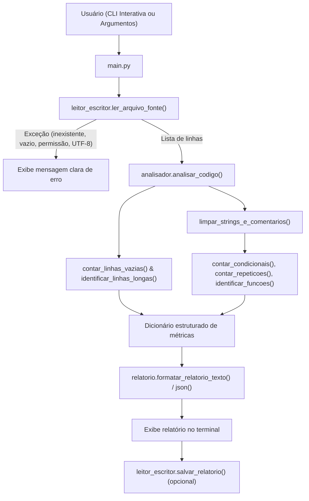

# Documentação Técnica – Organização do Código, Funções e Algoritmos

Este documento descreve a arquitetura modular, as estruturas de dados, os algoritmos implementados e as decisões técnicas do **Analisador de Código-Fonte Python**.

---

## 1. Organização Modular do Projeto

Seguindo os princípios da **Programação Estruturada**, o código foi separado em módulos coesos, cada um com responsabilidade bem definida, evitando concentrar toda a lógica em um único bloco:

```text
PE_Projeto_Final/
├── src/
│   ├── __init__.py          # Inicialização do pacote
│   ├── leitor_escritor.py   # Operações de leitura/gravação de arquivos e exceções
│   ├── analisador.py        # Sanitização léxica, regex e extração de métricas
│   ├── relatorio.py         # Formatação do relatório em texto (.txt) e JSON (.json)
│   └── main.py              # Interface CLI (menu interativo + argumentos)
├── exemplos/                # Arquivos Python usados nos testes manuais e automatizados
├── relatorios/              # Exemplos de relatórios gerados pelo programa
├── tests/
│   └── test_analisador.py   # Testes automatizados com unittest
└── docs/                    # Documentação das Etapas 1 e 2
```

### Fluxo Geral de Execução



---

## 2. Descrição dos Módulos e Principais Funções

### 2.1. `src/leitor_escritor.py` (Manipulação de Arquivos)

Centraliza toda a comunicação com o sistema de arquivos utilizando gerenciadores de contexto (`with open(..., encoding="utf-8")`), que garantem o fechamento automático dos arquivos mesmo quando ocorrem erros.

- **`ArquivoVazioError(Exception)`:** exceção personalizada criada para sinalizar explicitamente que o arquivo existe, mas possui 0 bytes / 0 linhas.
- **`validar_extensao_python(caminho_arquivo)`:** utiliza `os.path.splitext` para verificar se a extensão do arquivo é `.py`.
- **`ler_arquivo_fonte(caminho_arquivo)`:**
  1. Valida se o caminho não está vazio (`ValueError`);
  2. Verifica existência (`FileNotFoundError`) e se não é diretório (`IsADirectoryError`);
  3. Lê o conteúdo via `arquivo.readlines()` em UTF-8 (`PermissionError`, `UnicodeDecodeError`, `OSError`);
  4. Lança `ArquivoVazioError` se a lista de linhas estiver vazia.
- **`salvar_relatorio(caminho_saida, conteudo)`:** valida o caminho, cria diretórios pai automaticamente via `os.makedirs(..., exist_ok=True)` e grava o texto no disco.
- **`gerar_nome_relatorio_padrao(caminho_entrada, diretorio_saida, formato)`:** gera uma sugestão amigável de nome de arquivo de saída (ex.: `relatorios/relatorio_exemplo_basico.txt`).

---

### 2.2. `src/analisador.py` (Núcleo de Análise)

É o coração do projeto. Contém as expressões regulares pré-compiladas e as funções especializadas para cada métrica:

- **`limpar_strings_e_comentarios(linhas)`:** remove o conteúdo de literais de string e comentários `#`, retornando `(linhas_limpas, estatisticas_comentarios)` preservando exatamente a quantidade e a numeração original das linhas.
- **`contar_linhas_vazias(linhas)`:** aplica `PADRAO_LINHA_VAZIA` sobre cada linha original (sem `\r\n`) para contar linhas em branco ou com apenas espaços/tabs.
- **`contar_condicionais(linhas_limpas)`:** aplica `PADRAO_IF` e `PADRAO_ELIF` sobre as linhas sanitizadas e retorna `{"if": ..., "elif": ...}`.
- **`contar_repeticoes(linhas_limpas)`:** aplica `PADRAO_FOR` e `PADRAO_WHILE` sobre as linhas sanitizadas e retorna `{"for": ..., "while": ..., "total": ...}`.
- **`identificar_funcoes(linhas_limpas)`:** percorre as linhas sanitizadas com `enumerate(..., start=1)` aplicando `PADRAO_DEF` e retorna uma lista de dicionários `{"nome": ..., "linha": ...}`.
- **`identificar_linhas_longas(linhas, limite_caracteres)`:** verifica o comprimento de cada linha **original** (sem quebra de linha) contra `limite_caracteres`, retornando número da linha, tamanho e um trecho resumido (até 60 caracteres).
- **`analisar_codigo(linhas, nome_arquivo, limite_caracteres)`:** função orquestradora que chama todas as funções auxiliares e consolida o resultado em um único dicionário estruturado.

---

### 2.3. `src/relatorio.py` (Formatação de Saída)

Separa a lógica de apresentação da lógica de análise (princípio da separação de responsabilidades):

- **`_calcular_percentual(parte, total)`:** calcula percentuais protegendo contra divisão por zero.
- **`formatar_relatorio_texto(resultado, data_hora)`:** gera o relatório tabular legível para humanos com percentuais, listas numeradas de funções e linhas longas.
- **`formatar_relatorio_json(resultado, data_hora)`:** serializa o dicionário de métricas com `json.dumps(..., ensure_ascii=False, indent=2)`.

---

### 2.4. `src/main.py` (Interface de Linha de Comando)

Implementa os dois modos de execução:
- **Modo interativo (`executar_modo_interativo`):** laço `while True` exibindo o menu principal e chamando funções específicas para cada opção (`fluxo_analise_interativa`, `solicitar_limite_caracteres`, `exibir_ajuda`).
- **Modo por argumentos (`executar_modo_argumentos`):** utiliza `argparse` para aceitar arquivo de entrada, `-o/--saida`, `-l/--limite` e `-f/--formato`.
- **`executar_analise_arquivo(caminho, limite)`:** captura cada classe de exceção de `ler_arquivo_fonte` individualmente para apresentar mensagens claras e educativas ao usuário.

---

## 3. Explicação Detalhada dos Algoritmos Implementados

### 3.1. Algoritmo de Sanitização de Strings e Comentários (Desafio Adicional)

Remover comentários e strings apenas com expressões regulares simples costuma falhar em casos comuns do Python, como:
- `#` aparecendo dentro de uma string (`texto = "cor #FF0000"`);
- aspas simples ou duplas aparecendo dentro de um comentário (`# don't count if`);
- aspas escapadas dentro de uma string (`"aspas \"if\" internas"`);
- strings/docstrings que se estendem por várias linhas (`"""..."""` ou `'''...'''`).

Para resolver esses casos com precisão e complexidade linear **$O(N)$** (onde $N$ é o número total de caracteres do arquivo), a função `limpar_strings_e_comentarios` utiliza uma **máquina de estados finitos** com três estados:

1. **Estado `código normal`** (`delimitador_multilinha is None` e `delimitador_simples is None`):
   - Se a linha inteira começa com espaços opcionais e `#`, incrementa `linhas_comentarios` e registra linha vazia em `linhas_limpas`.
   - Ao encontrar `#` no meio da linha, marca `tem_comentario_inline = True` e interrompe a leitura daquela linha (`break`).
   - Ao encontrar `"""` ou `'''`, entra no estado de **string multilinha**, insere um espaço separador e avança 3 posições.
   - Ao encontrar `"` ou `'`, entra no estado de **string simples**, insere um espaço separador e avança 1 posição.
   - Qualquer outro caractere é copiado normalmente para `resultado_chars`.
2. **Estado `string simples`** (`delimitador_simples` é `"` ou `'`):
   - Se encontrar `\`, pula o caractere de escape e o próximo caractere (`i += 2`), evitando encerrar a string prematuramente em `\"` ou `\'`.
   - Ao encontrar o delimitador correspondente, sai da string e insere um espaço separador.
3. **Estado `string multilinha`** (`delimitador_multilinha` é `"""` ou `'''`):
   - Persiste **entre linhas** até encontrar o fechamento correspondente (`"""` ou `'''`), também respeitando escapes `\`.
   - Garante que comentários simulados (`#`) ou palavras reservadas dentro de docstrings nunca sejam contabilizados.

> **Por que inserir um espaço ao substituir uma string?**
> Se o código contivesse `if"a"in lista:`, apagar `"a"` sem espaço produziria `ifin lista:` (fundindo tokens). Substituir o literal por um espaço gera `if in lista:`, preservando corretamente a separação léxica.

---

### 3.2. Expressões Regulares Utilizadas

Todas as expressões são pré-compiladas com `re.compile()` no módulo `src/analisador.py` para melhor legibilidade e desempenho:

| Constante | Expressão Regular | O que identifica e por quê |
| :--- | :--- | :--- |
| `PADRAO_LINHA_VAZIA` | `r"^\s*$"` | `^` (início), `\s*` (zero ou mais espaços/tabs), `$` (fim). Identifica linhas vazias ou com apenas espaços em branco. |
| `PADRAO_COMENTARIO_LINHA` | `r"^\s*#"` | Início da linha seguido de indentação opcional e `#`. Identifica linhas de comentário puro. |
| `PADRAO_IF` | `r"\bif\b"` | `\b` marca fronteiras de palavra: captura `if`, mas **não** captura `elif`, `verificar_if` ou `dif`. |
| `PADRAO_ELIF` | `r"\belif\b"` | Captura ocorrências exatas da palavra reservada `elif`. |
| `PADRAO_FOR` | `r"\bfor\b"` | Captura `for` exato, evitando falsos positivos como `formato` ou `informacao`. |
| `PADRAO_WHILE` | `r"\bwhile\b"` | Captura `while` exato, evitando falsos positivos como `while_ativo`. |
| `PADRAO_DEF` | `r"^\s*(?:async\s+)?def\s+([A-Za-z_]\w*)\s*\("` | Indentação opcional (`^\s*`), prefixo opcional não-capturante `(?:async\s+)?`, palavra `def`, grupo de captura `([A-Za-z_]\w*)` para o nome válido da função seguido de `(`. |

---

### 3.3. Estruturas de Dados e Classificação das Linhas

- **Listas (`list`):** armazenam sequencialmente as linhas lidas, as linhas sanitizadas, a lista de funções encontradas e a lista de linhas longas (preservando a ordem de aparição no arquivo).
- **Dicionários (`dict`):** organizam os resultados por chaves semânticas (`"condicionais"`, `"repeticoes"`, `"funcoes"`, `"linhas_longas"`), facilitando tanto a leitura no código quanto a serialização direta para JSON.
- **Invariante de contagem de linhas:** a classificação garante que os três grupos principais sejam mutuamente exclusivos:
  $$\text{total\_linhas} = \text{linhas\_codigo} + \text{linhas\_vazias} + \text{linhas\_comentarios}$$
  Os comentários *inline* são reportados à parte como informação complementar para não duplicar a contagem de linhas.

---

## 4. Limitações Conhecidas e Possíveis Melhorias

Conhecer os limites de uma solução textual é fundamental em engenharia de software:

1. **Expressões dentro de *f-strings* (`f"{a if cond else b}"`):** como a sanitização descarta todo o conteúdo entre aspas conforme proposto no desafio, eventuais expressões `if` ou `for` embutidas em chaves `{...}` de uma *f-string* não são contabilizadas.
2. **Expressões geradoras e *list comprehensions* (`[x for x in lista if x > 0]`):** como a análise é léxica/textual baseada em palavras reservadas, os `for` e `if` presentes em compreensões de lista e operadores ternários também são contabilizados (além de blocos tradicionais terminados em `:`).
3. **Strings de linha única quebradas com barra invertida (`\` no fim da linha):** o analisador encerra strings de aspas simples/duplas ao final da linha para evitar que arquivos com erro de sintaxe comprometam toda a análise restante.
4. **Possível evolução futura:** integrar o módulo nativo `ast` (*Abstract Syntax Tree*) do Python para distinguir sintaticamente laços de bloco (`ast.For`) de compreensões (`ast.ListComp`), ou parametrizar a tabela de delimitadores de comentário para suportar múltiplas linguagens (como C, Java e JavaScript).
